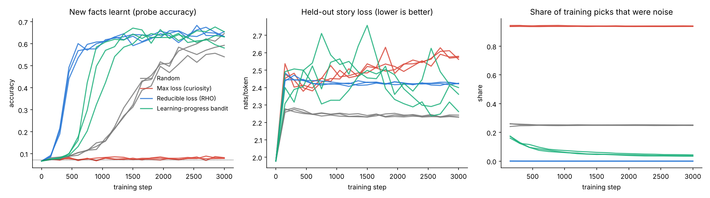
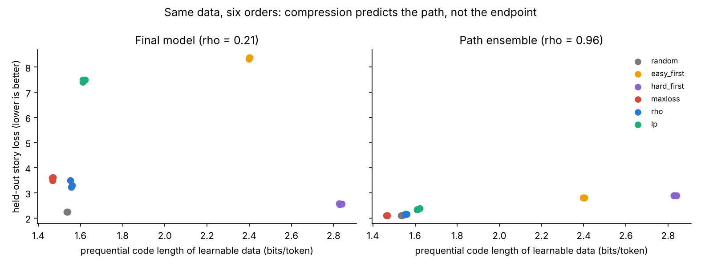
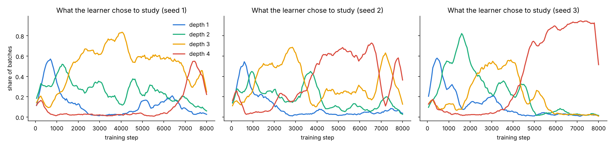
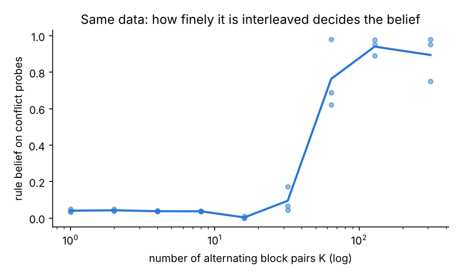

# What to Learn, and in What Order: Self-Directed Learning in Language Models Through the Lens of Compression

**Research report (Exp 01-10)** · November 2026
Code, data pipelines, pre-registrations and every run: `github.com/inny0127/llm-exp`

> **Method note.** Every experiment was pre-registered. Hypotheses and pass/fail criteria were
> fixed and committed before any full run. Hypotheses that held and hypotheses that failed are
> both reported as they came out.

---

## Summary

**Question.** People decide what to study next and what to ignore. What happens when a
language model gets the ability to choose its own next training data? And how does that
choice relate to the view, often associated with Ilya Sutskever, that compression is
generalisation?

Seven pre-registered experiments (Exp 04-10, 126 training runs) used small GPT models and
controlled data. The main findings:

1. **Curiosity alone falls into traps.** A model that picks the data with the highest loss
   spent 94% of its training on random noise. Models that pick by *reducible loss* or by
   *learning progress* spent only 0-4% on noise. (Exp 04)
2. **Order changes compression.** The same data, learnt for the same number of steps,
   compressed to prequential code lengths that differed by up to 1.4 bits per token
   depending only on the order. That is more than 200 times the seed-to-seed spread. No order
   compressed noise below its entropy of 12 bits. (Exp 05)
3. **Compression predicts the path, not the endpoint.** Code length barely predicted the final
   model's generalisation (Spearman ρ = 0.21). It almost perfectly predicted that of the
   *path ensemble*, the averaged predictions of checkpoints along training (ρ = 0.96). This
   is the central result of the work. (Exp 08)
4. **Compression progress rediscovers the syllabus.** On function-composition tasks, a learner
   that picks what to study only by compression progress followed the hidden dependency
   order, depth 1 → 2 → 3 → 4, in all three seeds (Kendall τ = 1.0). Nobody told it that
   order. Its generalisation to unseen compositions, however, was weaker than random
   ordering. (Exp 06, 09)
5. **How finely data is interleaved decides what the model believes, and the switch is a
   phase transition.** The dataset was fixed. The only variable was how many times shortcut
   blocks and counterexample blocks alternated. That alone decided whether the model learnt
   the rule or the shortcut. Rule belief jumped from 0.10 to 0.76 between 32 and 64 block
   pairs. (Exp 07, 09)

---

## 1. Background and motivation

This work grew out of earlier continual-learning experiments (Exp 01-03).

- **What Exp 01-03 tested.** Exp 01-03 tested "two-speed weights" as a way to keep learning new
  facts without losing old ones. New facts are written first into a fast sparse memory, then
  consolidated into slow dense weights during "sleep".
- **What they found.** The write side, protected sparse writes, scaled well. At 8x model
  size it lost only 0.7 points of old knowledge. The sleep side, in contrast, eroded old
  knowledge a little with every sleep.
- **The question that followed.** The common thread behind every failure was *what* is
  learnt, *when*, and *in what order*. So the question changed: what happens if the model
  chooses what to learn?

**Theory.**
- **Compression is generalisation (Sutskever, 2023).** A learner that compresses data well
  generalises well.
- **Prequential code length (Blier & Ollivier, 2018).** Go through the data once and add up
  the loss on each item just before learning it. The sum is the length of the learner's
  code for the data.
- **Kolmogorov complexity.** The complexity of a dataset, taken as a set, does not depend on
  order. The code length a given learner actually reaches can.
- **Curiosity as compression progress (Schmidhuber; Graves et al., 2017).** Good curiosity
  picks the data whose compression improves most.
- **Data selection (Mindermann et al., 2022, RHO-LOSS).** Pick data that is learnable,
  worth learning, and not yet learnt.

## 2. Methods (shared)

- **Model.** A 4-layer GPT with 3.8M parameters, starting from a prior pretrained on 20M
  tokens of TinyStories. Exp 06-07 trained a small model from scratch.
- **Data pool.** Four sources, in equal shares:
  - **stories:** held-out TinyStories text
  - **facts:** profiles of 300 invented people
  - **noise:** uniformly random tokens, which cannot be learnt
  - **dupes:** 64 story windows repeated, which are learnt quickly
- **Selection policies.**
  - **random**
  - **max loss (curiosity):** the highest current loss
  - **reducible loss (RHO-LOSS):** current loss minus a reference model's loss
  - **learning-progress bandit:** an Exp3 bandit rewarded by the loss drop on the batch just
    learnt
  - **value-function teacher (Exp 10):** a reinforcement-learning Q-function. Its reward is
    minus the code cost of each batch. Maximising return is then exactly minimising the code
    length of the whole dataset.
- **Evaluation.**
  - held-out story loss
  - new-fact accuracy, on a training template and on a template never seen in training
  - code length in bits per token
- **Rigour.**
  - three or more seeds per condition
  - hypotheses committed before running
  - hyperparameters set once, never tuned
  - every rerun after a bug or out-of-memory error, and every failed attempt, recorded
- **Compute.** CPU, free Colab T4 and a rented RTX 4090. The 126 runs took about 3-4 hours on
  the 4090, for about $1-2. Remote GPU machines were provisioned, driven and shut down from
  scripts, through the Colab CLI and the RunPod API.

## 3. Results

### 3.1 Exp 04: Choosing what to learn

| Policy | New-fact accuracy | Story loss | Share of picks that were noise |
|---|---|---|---|
| Random | 0.59 | **2.23** | 25% |
| Max loss (curiosity) | 0.08 | 2.57 | **94%** |
| Reducible loss | **0.64** | 2.42 | 0% |
| Learning-progress bandit | 0.62 | 2.34 | 4% |

- **Held.** Curiosity fell into the "noisy TV" trap (H1). Reducible loss and learning progress
  avoided the noise (H4).
- **Failed.** The prediction that they would beat random by at least 0.10 in fact accuracy
  (H2, H3) did not hold. The gain was +0.03 to +0.05, and it came at the cost of worse story
  loss: selecting something always means giving something up.

### 3.2 Exp 05: Same data, different order, different compression

| Order | Code length, learnable part (bits/token) | Story loss (final model) | New-fact accuracy |
|---|---|---|---|
| Random | 1.54 | **2.24** | **0.31** |
| Easy first | 2.40 | 8.36 | 0.07 |
| Hard first | 2.83 | 2.56 | 0.08 |
| Max loss first | **1.47** | 3.57 | 0.21 |
| Reducible loss | 1.56 | 3.34 | 0.09 |
| Learning progress | 1.62 | 7.47 | 0.07 |

- **H1 held.** Order alone changed code length by 1.4 bits per token.
- **H4 held.** No order coded noise below 12 bits per token.
- **H2 failed in part.** Code length barely correlated with the final model's story loss
  (ρ = 0.21).
- **H3 failed.** The learning-progress order compressed worse than random (1.62 vs 1.54),
  the opposite of "picking by compression progress shortens the code".
- **Finding.** Every item had to be learnt once. So orders that deferred the noise ended the
  epoch on nothing but noise, and the final model collapsed (story loss 7-8). **Deferring
  unavoidable data does not make it go away. It moves the damage to the end.**

### 3.3 Exp 08: Compression predicts the path (central result)

Theory explains the gap seen in Exp 05. The prequential code length is not a property of the
last model. It is a property of the *sequence of models along the learning path*. So Exp 08
also evaluated a "path ensemble": the averaged predictive distribution of 10 checkpoints.

| | Correlation of code length with story loss |
|---|---|
| Final model | ρ = 0.21 |
| **Path ensemble** | **ρ = 0.96** |

- **H1 held.** The correlation rose from 0.21 to 0.96.
- **H2 held.** Orders whose final model collapsed recovered under the path ensemble. Easy
  first went from 8.36 to 2.80, and learning progress from 7.47 to 2.35.
- **H3 and H4 failed.** A "right to refuse" rule skipped items the learner coded no better
  than chance. It filtered out all of the noise, but it did not stop the last-learnt block
  from dominating under blocked orders. Noise was only one cause.

**Interpretation.** "Compression implies generalisation" breaks when applied to the last
model alone. It holds almost perfectly for the learning path as a whole. This matches the
online-to-batch conversion of online learning theory. Here it is measured directly, as the
link between data order and compression.

### 3.4 Exp 06 and 09: Rediscovering the syllabus by compression alone

- **Setup.** Three base functions (x+1, 2x, x²+1, mod 23) were composed to depth 1-4. A
  quarter of the depth-3 and depth-4 compositions were never trained; they test
  generalisation.
- **H1 held (Exp 06 and 09).** The compression-progress learner studied in the order
  1 → 2 → 3 → 4 in all three seeds (τ = 1.0). Each depth's share peaked, on average, at steps
  583, 1,267, 3,600 and 7,050.
- **H2 failed.** On unseen compositions, the curriculum learner was weaker than random order
  (0.66):
  - one depth per batch: 0.22
  - all depths mixed with a 10% floor each, i.e. review (Exp 09): 0.53, with the syllabus
    still rediscovered (τ = 1.0)
- **Interpretation.** Following the syllabus seems to push the model toward memorising
  compositions one by one. Mixing seems to push it toward learning the rule.

### 3.5 Exp 07 and 09: Order decides belief, and the switch is a phase transition

- **Setup.** The answer is always z = x + y (mod 23).
  - In 80% of items a "tag" equals the answer, so copying the tag also works.
  - In the other 20% the tag is random, so only the rule works.
  - The fixed dataset is learnt once, in different orders. Conflict probes, where the tag
    differs from the answer, then show what the model believes.
- **Exp 07.**
  - Random interleaving led to belief in the rule (0.85).
  - Splitting into blocks prevented the rule from being learnt (0.00-0.04).
  - The pre-registered contrast was rule-first vs rule-last. Both failed, so their
    difference was small and H1 failed.
- **Exp 09 (H4 and H5 held).** The number of alternating block pairs K was swept from 1 to
  312. Rule belief did not rise gradually. **It jumped from 0.10 to 0.76 between K = 32 and
  K = 64.**

### 3.6 Exp 10: A value-function (reinforcement learning) teacher

| Policy | Code length | Story loss | When noise was learnt (0 = start, 1 = end) |
|---|---|---|---|
| Random | 2.26 | 2.32 | 0.48 |
| Learning-progress bandit | **2.21** | 4.09 | 0.64 |
| **Value-function teacher** | 2.41 | 2.40 | 0.81 |

- **H1 and H2 failed.** During training, the teacher reached shorter codes than random
  (2.17-2.20). Its greedy policy did not keep that advantage at evaluation (2.41). And,
  contrary to the prediction that it would consume the noise early, it learnt to defer the
  noise.
- **H3 held.** Deferring the noise did not wreck the final model (story loss 2.40). The
  dataset was a quarter of Exp 05's size, which limits the comparison.
- **Interpretation.** 30 episodes were most likely too few to learn the value function.

## 4. Discussion

| Finding | Evidence | Meaning |
|---|---|---|
| Good curiosity looks at what is *reducible* | Exp 04 | Raw loss is fooled by noise |
| Order changes compression | Exp 05; ρ 0.21 → 0.96 in Exp 08 | Compression-generalisation is a property of the path |
| Compression progress rediscovers structure | Exp 06, τ = 1.0 | The rediscovered syllabus is not the best for generalisation |
| Interleaving decides belief | Exp 09, transition at K = 32-64 | Counterexample spacing has a critical point |

**Limitations.**
- The models are small (3.8M parameters) and the data synthetic.
- Each result rests on three seeds.
- Some key contrasts were exploratory, not pre-registered: Exp 07's interleaved vs blocked
  comparison is one of them.
- The theoretical backbone, online-to-batch conversion and checkpoint averaging, is already
  known. The contribution is controlled experiments showing how the principle shows up in
  data-order selection, and where it breaks.

## 5. Next steps (research vision)

1. **Test "the path generalises" on a real LLM.** Inject recent facts into Qwen2.5-0.5B in
   different orders. Then check whether code length predicts, *in advance*, the generalisation
   of the weight-averaged model. About one day on an RTX 5090, about $10.
2. **A law for counterexample spacing.** First measure the time T it takes a shortcut to set
   in. Then predict the critical interleaving point K* from T, before sweeping K. Check the
   prediction across settings and on real LLM fine-tuning. If it holds, it gives a
   quantitative rule for how densely counterexamples or safety data must be interleaved.
3. **Choosing data mixtures by code length.** Test whether training-loss logs alone can pick
   a good data mixture, without expensive evaluation.

## Appendix: Experiments and files

| Experiment | Content | Pre-registration | Results |
|---|---|---|---|
| Exp 01-03 | Two-speed weights (continual learning) | `exp0{1,2,3}*/DESIGN.md` | `RESULTS.md` |
| Exp 04 | Four data-selection policies | `exp04_curriculum/DESIGN.md` | `exp04_curriculum/results_gpu/` |
| Exp 05 | Order and code length | `exp05_order_compression/DESIGN.md` | `exp05_order_compression/results/` |
| Exp 06, 07 | Rediscovering the syllabus; order and belief | `exp06_worlds/DESIGN.md` | `exp06_worlds/results/` |
| Exp 08 | Path ensemble; refusal | `exp05_order_compression/DESIGN_exp08.md` | `exp05_order_compression/results08/` |
| Exp 09 | Syllabus with review; block count and phase transition | `exp06_worlds/DESIGN_exp09.md` | `exp06_worlds/results09/` |
| Exp 10 | Value-function teacher | `exp10_value/DESIGN.md` | `exp10_value/results/` |
