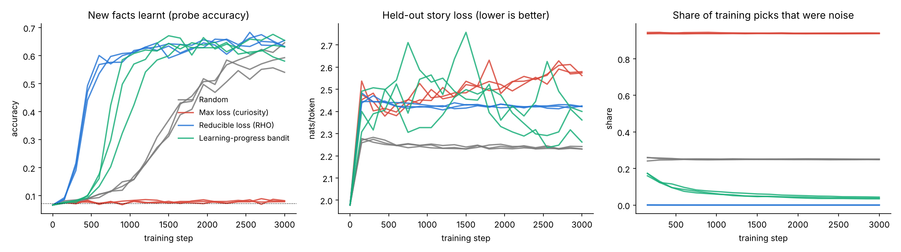
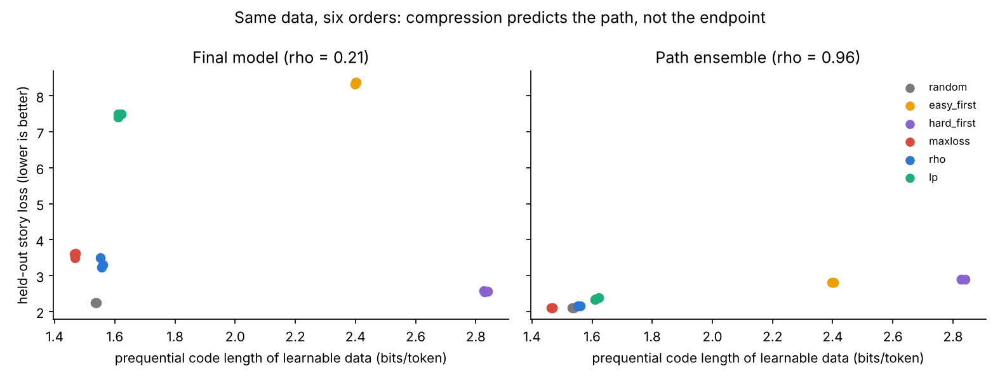
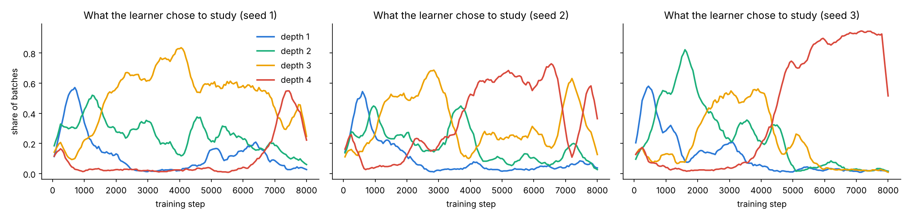
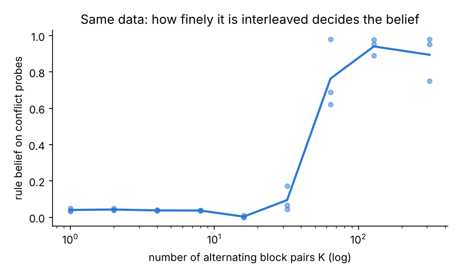

# 무엇을, 어떤 순서로 배울 것인가: 압축 관점에서 본 언어모델의 자기주도 학습

**연구 보고서 (Exp 01-10)** · 2026년 11월
코드, 데이터, 사전 등록 문서, 모든 실행 결과: `github.com/inny0127/llm-exp` (브랜치 `claude/experiment-design-run-sjkj74`)

> **작업 방식 공개.** 이 연구에서 질문과 방향, 실험 선택, 결과 판단은 제가 정했습니다. 실험 설계 세부, 코드 작성, 실행, 분석은 AI 코딩 에이전트(Anthropic의 Claude)와 함께 했습니다. 모든 실험은 실행 전에 가설과 판정 기준을 문서로 고정하고 커밋하는 사전 등록 방식으로 진행했습니다. 맞은 가설과 틀린 가설을 모두 그대로 보고합니다.

---

## 요약

**질문.** 사람은 무엇을 먼저 배울지, 무엇은 버릴지 스스로 정합니다. 언어모델에게 "다음에 배울 데이터를 고르는 능력"을 주면 어떻게 될까요? 그리고 그 선택은 Ilya Sutskever가 말한 "압축이 곧 일반화"라는 관점과 어떻게 연결될까요?

작은 GPT 모델과 통제된 합성 데이터로 사전 등록 실험 7개(Exp 04-10, 총 126회 학습)를 진행했습니다. 주요 결과는 다음과 같습니다.

1. **호기심만으로는 함정에 빠집니다.** 손실이 큰 데이터를 고르는 모델은 학습 시간의 94%를 무작위 노이즈에 썼습니다. "줄일 수 있는 손실"이나 "학습 진전"을 기준으로 고르는 모델은 노이즈를 0-4%만 골랐습니다. (Exp 04)
2. **순서는 압축을 바꿉니다.** 같은 데이터를 같은 횟수로 배워도, 순서만 바꾸면 데이터를 압축하는 길이(prequential code length)가 토큰당 최대 1.4비트 달라졌습니다. 시드 간 차이의 200배가 넘습니다. 그리고 어떤 순서로도 노이즈를 이론적 하한(12비트) 아래로 압축하지는 못했습니다. (Exp 05)
3. **압축은 끝점이 아니라 경로를 예측합니다.** 압축 길이는 마지막 모델의 성능과는 거의 무관했습니다(ρ = 0.21). 반면 학습 경로 위 체크포인트들의 예측을 평균한 모델의 성능은 거의 완벽하게 예측했습니다(ρ = 0.96). 이것이 이 연구의 가장 중요한 결과입니다. (Exp 08)
4. **모델은 압축만으로 교과 과정을 재발견합니다.** 함수 합성 문제에서 "압축 진전"만 보고 공부할 내용을 고른 모델이, 아무도 알려 주지 않은 의존 구조(깊이 1 → 2 → 3 → 4)를 3개 시드 모두에서 정확한 순서로 따라갔습니다(Kendall τ = 1.0). 다만 처음 보는 조합에 대한 일반화는 무작위 순서보다 약했습니다. (Exp 06, 09)
5. **섞는 정도가 믿음을 결정하고, 그 전환은 상전이처럼 일어납니다.** 같은 데이터라도 꼼수(지름길)와 반례를 몇 번 번갈아 보여 주느냐에 따라 모델이 규칙을 배우거나 꼼수를 배웠습니다. 블록 수 32에서 64 사이에서 규칙을 믿는 비율이 0.10에서 0.76으로 한 번에 뛰었습니다. (Exp 07, 09)

---

## 1. 배경과 동기

이 연구는 앞선 지속 학습 실험(Exp 01-03)에서 출발했습니다.

- **Exp 01-03의 내용.** 새 사실을 계속 배우면서 기존 지식을 잃지 않는 방법으로 "두 속도 가중치"를 시험했습니다. 빠른 희소 메모리에 먼저 적고, 수면 단계에서 느린 가중치로 옮기는 방식입니다.
- **Exp 01-03의 결론.** 쓰기 쪽(보호된 희소 쓰기)은 모델을 8배 키워도 잘 작동했습니다(기존 지식 손실 0.7점). 반면 수면 단계는 수면할 때마다 기존 지식을 깎았습니다.
- **그로부터 나온 질문.** 실패의 원인은 공통적으로 "무엇을, 언제, 어떤 순서로 배우는가"였습니다. 그래서 질문을 바꿨습니다. 모델이 배울 내용을 스스로 고르게 하면 어떻게 될까요?

**이론적 배경.**
- **압축 = 일반화 (Sutskever, 2023).** 데이터를 잘 압축하는 학습자가 잘 일반화합니다.
- **Prequential 압축 길이 (Blier & Ollivier, 2018).** 데이터를 하나씩 보면서 "배우기 직전의 손실"을 모두 더한 값입니다. 학습자가 데이터를 압축한 길이에 해당합니다.
- **Kolmogorov 복잡도.** 데이터 집합 자체의 복잡도는 순서와 무관합니다. 그러나 특정 학습자가 실제로 도달하는 압축 길이는 순서에 따라 달라질 수 있습니다.
- **호기심과 학습 진전 (Schmidhuber; Graves 외, 2017).** 압축이 가장 많이 개선되는 데이터를 고르는 것이 좋은 호기심입니다.
- **데이터 선택 (Mindermann 외, 2022, RHO-LOSS).** "배울 수 있고, 배울 가치가 있고, 아직 안 배운" 데이터를 고릅니다.

## 2. 방법 (공통)

- **모델.** 4층 GPT(파라미터 380만 개)입니다. TinyStories 2,000만 토큰으로 사전학습한 모델을 출발점으로 썼습니다. Exp 06-07은 작은 모델을 처음부터 학습했습니다.
- **데이터 풀.** 네 출처를 같은 비율로 섞었습니다.
  - **이야기:** TinyStories 원문
  - **새 사실:** 지어낸 인물 300명의 프로필
  - **노이즈:** 완전히 무작위인 토큰. 배울 수 없는 데이터입니다.
  - **중복:** 같은 이야기 64개를 반복. 금방 다 배우는 데이터입니다.
- **선택 방법.**
  - **무작위**
  - **최대 손실 (호기심):** 현재 손실이 가장 큰 데이터를 고릅니다.
  - **줄일 수 있는 손실 (RHO-LOSS):** 현재 손실에서 참조 모델의 손실을 뺀 값이 큰 데이터를 고릅니다.
  - **학습 진전 밴딧:** Exp3 밴딧을 씁니다. 방금 배운 배치에서 손실이 얼마나 줄었는지가 보상입니다.
  - **가치함수 선생님 (Exp 10):** 강화학습 Q함수를 씁니다. 보상은 "그 배치의 압축 비용에 마이너스를 붙인 값"입니다. 이렇게 하면 누적 보상을 최대화하는 것이 전체 압축 길이를 최소화하는 것과 정확히 같아집니다.
- **평가.**
  - 이야기 검증 손실
  - 새 사실 정답률 (학습 템플릿과, 학습에 한 번도 나오지 않은 템플릿)
  - 압축 길이 (토큰당 비트)
- **엄밀성.**
  - 모든 실험은 시드 3개 이상으로 돌렸습니다.
  - 가설과 판정 기준은 실행 전에 문서로 커밋했습니다.
  - 하이퍼파라미터는 한 번 정하고 조정하지 않았습니다.
  - 버그나 메모리 부족으로 다시 돌린 런과 실패한 시도도 모두 기록했습니다.
- **연산.** CPU, 무료 Colab T4, RunPod RTX 4090을 썼습니다. 4090에서는 126회 학습을 약 3-4시간, $1-2에 마쳤습니다. 학습 서버는 Colab CLI와 RunPod MCP로 에이전트가 직접 만들고, 실행하고, 종료했습니다.

## 3. 결과

### 3.1 Exp 04: 무엇을 배울지 고르기

| 방법 | 새 사실 정답률 | 이야기 손실 | 노이즈를 고른 비율 |
|---|---|---|---|
| 무작위 | 0.59 | **2.23** | 25% |
| 최대 손실 (호기심) | 0.08 | 2.57 | **94%** |
| 줄일 수 있는 손실 | **0.64** | 2.42 | 0% |
| 학습 진전 밴딧 | 0.62 | 2.34 | 4% |

- **맞은 가설.** 호기심은 노이즈에 빠졌습니다. 이른바 "noisy TV" 문제입니다(H1). 반면 줄일 수 있는 손실과 학습 진전은 노이즈를 피했습니다(H4).
- **틀린 가설.** 새 사실에서 무작위보다 0.10 이상 낫다는 가설(H2, H3)은 틀렸습니다. 실제 차이는 +0.03에서 +0.05였고, 그 대가로 이야기 손실이 나빠졌습니다. 무엇을 고르든 무엇을 버리는 트레이드오프가 있다는 뜻입니다.

### 3.2 Exp 05: 같은 데이터, 다른 순서, 다른 압축

| 순서 | 압축 길이 (학습 가능 부분, bits/token) | 이야기 손실 (마지막 모델) | 새 사실 정답률 |
|---|---|---|---|
| 무작위 | 1.54 | **2.24** | **0.31** |
| 쉬운 것 먼저 | 2.40 | 8.36 | 0.07 |
| 어려운 것 먼저 | 2.83 | 2.56 | 0.08 |
| 최대 손실 먼저 | **1.47** | 3.57 | 0.21 |
| 줄일 수 있는 손실 | 1.56 | 3.34 | 0.09 |
| 학습 진전 | 1.62 | 7.47 | 0.07 |

- **H1 맞음.** 순서만으로 압축 길이가 1.4비트 달라졌습니다.
- **H4 맞음.** 어떤 순서도 노이즈를 12비트 아래로 압축하지 못했습니다.
- **H2 일부 틀림.** 압축 길이와 마지막 모델의 이야기 손실 사이의 상관은 약했습니다(ρ = 0.21).
- **H3 틀림.** 학습 진전 순서의 압축 길이(1.62)가 무작위(1.54)보다 길었습니다. "압축 진전으로 고르면 압축이 짧아진다"는 예측과 반대였습니다.
- **발견.** 노이즈를 끝까지 미루는 순서는, 데이터를 한 번씩은 다 봐야 하므로 마지막에 노이즈만 연달아 배웠습니다. 그 결과 모델이 무너졌습니다(손실 7-8). **피할 수 없는 데이터는 미뤄도 사라지지 않고, 피해가 끝으로 옮겨질 뿐입니다.**

### 3.3 Exp 08: 압축은 경로를 예측한다 (핵심 결과)

Exp 05에서 압축 길이와 최종 성능이 어긋난 이유를 이론에서 찾았습니다. Prequential 압축 길이는 마지막 모델 하나의 성질이 아니라, **학습 경로 위 모델들 전체**의 성질입니다. 그래서 체크포인트 10개의 예측을 평균한 "경로 앙상블"로 다시 평가했습니다.

| | 압축 길이와 이야기 손실의 상관 |
|---|---|
| 마지막 모델 | ρ = 0.21 |
| **경로 앙상블** | **ρ = 0.96** |

- **H1 맞음.** 상관이 ρ = 0.21에서 0.96으로 올랐습니다.
- **H2 맞음.** 마지막 모델이 무너졌던 순서들도 경로 앙상블로 보면 회복됐습니다. 쉬운 것 먼저는 8.36에서 2.80으로, 학습 진전은 7.47에서 2.35로 좋아졌습니다.
- **H3, H4 틀림.** "우연보다 나을 게 없는 데이터는 거절"하는 규칙을 추가했습니다. 이 규칙은 노이즈를 100% 걸러냈지만, 덩어리로 배우는 순서의 "마지막에 배운 것이 이긴다" 문제는 해결하지 못했습니다. 노이즈는 원인 중 하나였을 뿐입니다.

**해석.** "압축하면 일반화한다"는 원리는 마지막 모델 하나에서는 깨지고, 학습 경로 전체에서는 거의 완벽하게 성립했습니다. 이는 온라인 학습 이론의 online-to-batch 변환과 일치합니다. 데이터 순서와 압축의 관계를 직접 측정해 보여 준 결과입니다.

### 3.4 Exp 06, 09: 압축만으로 교과 과정을 재발견

- **설정.** 기본 함수 3개(x+1, 2x, x²+1, mod 23)를 깊이 1-4로 합성한 문제를 만들었습니다. 깊이 3과 4에서는 조합의 4분의 1을 학습에서 빼고 일반화 시험용으로만 썼습니다.
- **H1 맞음 (Exp 06, 09).** 압축 진전으로 고르는 모델이 3개 시드 모두에서 깊이 1 → 2 → 3 → 4 순서로 공부했습니다(τ = 1.0). 깊이별로 가장 집중한 시점은 평균 583, 1,267, 3,600, 7,050스텝이었습니다.
- **H2 틀림.** 처음 보는 조합에서의 정답률은 무작위 순서(0.66)보다 낮았습니다.
  - 한 번에 한 깊이만 고르는 방식: 0.22
  - 모든 깊이를 최소 10%씩 섞어 복습하는 방식(Exp 09): 0.53. 교과 순서 재발견(τ = 1.0)은 그대로 유지했습니다.
- **해석.** 교과 순서대로 배우면 조합을 하나씩 외우는 쪽으로, 섞어서 배우면 규칙을 익히는 쪽으로 가는 것으로 보입니다.

### 3.5 Exp 07, 09: 순서가 믿음을 결정하고, 전환은 상전이처럼 일어난다

- **설정.** 정답은 항상 z = x + y (mod 23)입니다. 데이터의 80%는 "태그"가 정답과 같아서 태그를 베끼는 꼼수로도 맞힙니다. 나머지 20%는 태그가 무작위라 규칙으로만 맞힙니다. 같은 데이터를 순서만 바꿔 한 번씩 학습한 뒤, 태그와 정답이 다른 문제로 모델이 무엇을 믿는지 측정했습니다.
- **Exp 07.**
  - 무작위로 섞으면 규칙을 믿었습니다(0.85).
  - 덩어리로 나누면 규칙을 못 배웠습니다(0.00-0.04).
  - 다만 사전 등록 가설은 "규칙 데이터를 먼저 주는 순서와 나중에 주는 순서의 차이"였는데, 이 둘이 모두 실패해서 차이가 작았습니다. 그래서 H1은 틀렸습니다.
- **Exp 09 (H4, H5 맞음).** 꼼수 데이터와 규칙 데이터를 번갈아 보여 주는 블록 수 K를 1부터 312까지 바꿨습니다. 규칙을 믿는 비율은 서서히 오르지 않았습니다. **K = 32와 64 사이에서 0.10에서 0.76으로 한 번에 뛰었습니다.**

### 3.6 Exp 10: 가치함수(강화학습) 선생님

| 방법 | 압축 길이 | 이야기 손실 | 노이즈를 배운 시점 (0 = 처음, 1 = 끝) |
|---|---|---|---|
| 무작위 | 2.26 | 2.32 | 0.48 |
| 학습 진전 밴딧 | **2.21** | 4.09 | 0.64 |
| **가치함수 선생님** | 2.41 | 2.40 | 0.81 |

- **H1, H2 틀림.** 선생님은 학습 도중에는 무작위보다 짧은 압축(2.17-2.20)에 도달했습니다. 그러나 탐색을 끈 평가에서는 그 성능을 유지하지 못했습니다(2.41). 또 "노이즈를 먼저 먹어 치울 것"이라는 예측과 반대로, 노이즈를 끝으로 미루는 전략을 배웠습니다.
- **H3 맞음.** 노이즈를 끝으로 미뤘는데도 이야기 손실은 무너지지 않았습니다(2.40). 다만 데이터 규모가 Exp 05의 4분의 1이라 직접 비교에는 한계가 있습니다.
- **해석.** 가치함수 학습에 30회 에피소드로는 부족했던 것으로 보입니다.

## 4. 종합 논의

| 발견 | 근거 | 의미 |
|---|---|---|
| 좋은 호기심은 "줄일 수 있는 것"을 본다 | Exp 04 | 단순 손실은 노이즈에 속는다 |
| 순서는 압축을 바꾼다 | Exp 05, ρ = 0.21 → 0.96 (Exp 08) | 압축-일반화 원리는 경로의 성질이다 |
| 압축 진전은 구조를 재발견한다 | Exp 06, τ = 1.0 | 하지만 재발견한 교과 과정이 일반화에 최적은 아니다 |
| 섞는 정도가 믿음을 결정한다 | Exp 09, K = 32-64 상전이 | 반례를 섞는 간격에는 임계점이 있다 |

**한계.**
- 모델이 작고(380만 파라미터) 데이터가 합성 데이터입니다.
- 각 결과가 시드 3개에 기반합니다.
- 일부 핵심 비교(Exp 07의 섞기 대 덩어리)는 사전 등록한 비교가 아닌 탐색적 결과입니다.
- 이론적 뼈대(online-to-batch, 체크포인트 평균)는 이미 알려져 있습니다. 이 연구의 기여는 그 원리가 데이터 순서 선택에서 어떻게 드러나고 어디서 깨지는지를 통제 실험으로 보인 데 있습니다.

## 5. 다음 연구 (비전)

1. **실제 LLM에서 "경로가 일반화한다" 검증.** Qwen2.5-0.5B에 최신 사실을 순서를 바꿔 주입하고, 압축 길이가 가중치 평균 모델의 성능을 **미리** 예측하는지 확인합니다. RTX 5090 기준 하루, 약 $10입니다.
2. **반례 간격의 법칙.** 꼼수가 굳는 데 걸리는 시간 T를 먼저 측정하고, 그 값으로 상전이 지점 K\*를 미리 예측합니다. 예측이 여러 조건과 실제 LLM fine-tuning에서 맞는지 검증합니다. 맞다면 안전 데이터나 반례를 얼마나 촘촘히 섞어야 하는지 정량 기준을 줄 수 있습니다.
3. **압축 길이로 데이터 혼합 비율 고르기.** 비싼 평가 없이, 학습 손실 기록만으로 좋은 데이터 구성을 고를 수 있는지 시험합니다.

## 부록: 실험 목록과 파일

| 실험 | 내용 | 사전 등록 | 결과 |
|---|---|---|---|
| Exp 01-03 | 두 속도 가중치 (지속 학습) | `exp0{1,2,3}*/DESIGN.md` | `RESULTS.md` |
| Exp 04 | 데이터 선택 정책 4종 | `exp04_curriculum/DESIGN.md` | `exp04_curriculum/results_gpu/` |
| Exp 05 | 순서와 압축 길이 | `exp05_order_compression/DESIGN.md` | `exp05_order_compression/results/` |
| Exp 06, 07 | 교과 과정 재발견, 순서와 믿음 | `exp06_worlds/DESIGN.md` | `exp06_worlds/results/` |
| Exp 08 | 경로 앙상블, 거절 | `exp05_order_compression/DESIGN_exp08.md` | `exp05_order_compression/results08/` |
| Exp 09 | 복습 교과 과정, 블록 수와 상전이 | `exp06_worlds/DESIGN_exp09.md` | `exp06_worlds/results09/` |
| Exp 10 | 가치함수 선생님 | `exp10_value/DESIGN.md` | `exp10_value/results/` |
