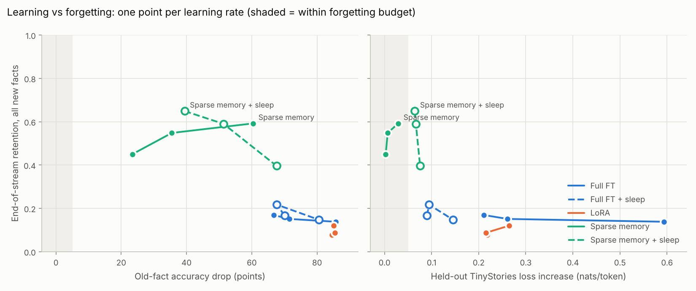
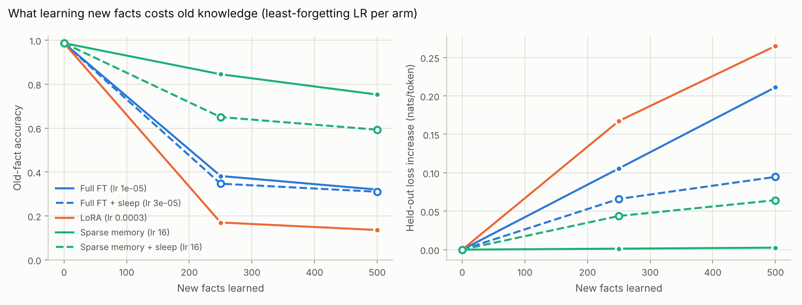
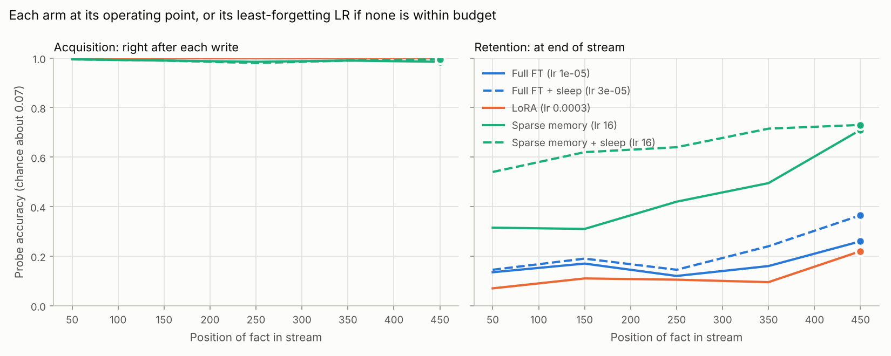
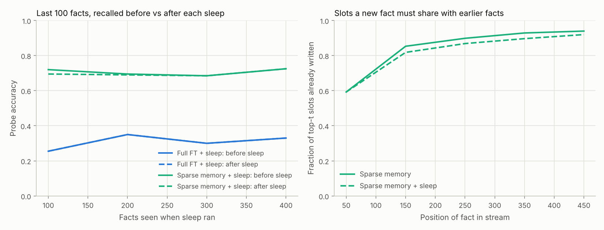

# Exp 01 results — Two-speed weights

**Bottom line.** The fast half works: sparse memory writes kept 2.6x more new
facts than full fine-tuning while losing a third as much old knowledge and
leaving general text untouched. The slow half works at its own job (sleep
moved facts into the dense weights almost losslessly and lifted retention by
20 points) but the dense update charges the bill to old knowledge and
general text. No arm stayed inside the pre-registered forgetting budget, so
Q2 fails by rule. Do not scale yet: both halves now have a named bottleneck
that can be tested on CPU in hours.

Test streams: seeds 1-2, 500 new facts each, 30 runs. Pretrained model:
held-out TinyStories loss 2.020 nats/token, old-fact accuracy 98.7%
(99.2% on the held-out template), new-fact accuracy before learning 6.5%
(chance about 7%).

## Verdict against the pre-registered rules

| Question | Rule | Result | Verdict |
|---|---|---|---|
| Q1: replication gate | Sparse memory forgets at most half as much as full FT (old facts and NLL) at LRs that learn | Old-fact drop 23.4 vs 66.7 points; delta NLL +0.003 vs +0.211 | **Pass** |
| Saturation | Early-fact retention 15+ points under acquisition, or late acquisition sags 10+ points | First 100 facts retained 0.32 vs acquisition 0.99; share of a new fact's slots already written climbs from 0.59 to 0.94 | **Present** |
| Q2: sleep adds something | Sparse+sleep operating point beats sparse by 10+ points of retention and full FT+sleep by 5+ | No arm has an operating point: every LR of every arm loses more than 20 points of old facts | **Fail** (rule cannot be met) |
| Informative failure | Sleep pushes forgetting past budget, or loses the facts it consolidates | Delta NLL +0.064 to +0.076 against a 0.05 budget; old-fact drop +7 to +16 points; consolidation itself loses under 1 point per sleep on average | **Yes**: the dense update is the bottleneck |

## Results

### 1. Sparse memory reproduces the fast-half result

Each arm at its least-forgetting LR among those that learn (acquisition >= 0.9):

| Arm | LR | Retention | Held-out template | First 100 facts | Old facts lost | Delta NLL | Steps/fact |
|---|---|---|---|---|---|---|---|
| Full FT | 1e-5 | 0.17 | 0.16 | 0.14 | 66.7 pts (-68%) | +0.211 | 6.6 |
| LoRA | 3e-4 | 0.12 | 0.11 | 0.07 | 85.1 pts (-86%) | +0.265 | 2.3 |
| Sparse memory | 16 | 0.45 | 0.38 | 0.32 | 23.4 pts (-24%) | +0.003 | 4.4 |

Meta's 1.3B model: -89% (full FT), -71% (LoRA), -11% (sparse) on
NaturalQuestions F1. Full FT vs sparse reproduces. LoRA does worse than full
FT here, plausibly because one small shared adapter is rewritten by every
fact.

### 2. Sleep consolidates, and old knowledge pays for it

Sleep minus no sleep, same LR and seeds:

| Write | LR | Retention | Held-out template | First 100 facts | Old-fact drop | Delta NLL |
|---|---|---|---|---|---|---|
| Sparse | 16 | **+0.20** | +0.23 | +0.23 | +16.0 pts | +0.062 |
| Sparse | 64 | +0.04 | +0.08 | -0.01 | +15.8 pts | +0.060 |
| Sparse | 256 | -0.20 | -0.15 | -0.26 | +7.2 pts | +0.046 |
| Full FT | 1e-5 | -0.00 | +0.00 | -0.07 | +3.4 pts | -0.121 |
| Full FT | 3e-5 | +0.07 | +0.07 | +0.05 | -3.8 pts | -0.167 |
| Full FT | 1e-4 | +0.01 | +0.03 | -0.01 | -5.1 pts | -0.448 |

- **It consolidates.** Recall of the last 100 facts drops by 0.4-0.8 points
  per sleep on average (worst single sleep: 5 points), even though their
  slots are reset.
- **It does not free slots.** The share of a new fact's slots already
  written still reaches 0.92 with sleep (0.94 without). TF-IDF keeps choosing
  the same slots, written or not. Sleep helps a different way than the thread
  hypothesised: facts copied into the dense weights survive later
  overwrites.
- **The sparse store is what makes sleep pay.** Sparse + sleep keeps 0.65 of
  new facts; the best full FT + sleep keeps 0.22. For full FT, sleep's replay
  mainly repairs general text (delta NLL down 0.12-0.45).
- **The cost.** At the best LR, sleep adds 16 points of old-fact loss and
  0.06 nats of NLL, despite 2,048 replay tokens per step.

### 3. Why sparse writes still hurt old facts

The slot probe below (dev section) shows TF-IDF picks slots that encode the
new entity's name: 88% of selected-slot reads happen on name tokens. Invented
names share syllable pieces, so 71% of those slots are also read when the
model recalls old entities, against an 18% base rate. The slots read at the
answer position are almost never touched (2.5%). Old answers are lost
because old *names* get garbled.

## Go / no-go

**No-go on scaling the current recipe; go on two cheap fixes first.** The
2x2 shows sparse writes plus sleep beat every dense alternative on
retention, so the idea is alive. Each bottleneck is a few hours on this
testbed:

1. **Fast half: slot collisions on entity names.** Exclude slots read by
   known entities from the TF-IDF selection, or write only slots read at the
   answer-predicting position. Pass bar: old-fact drop <= 10 points at
   retention >= 0.45.
2. **Slow half: collateral damage from the dense update.** Let sleep
   self-quiz on old entities too (replaying what the model already knows,
   not just pretraining text), or add a Fisher/curvature penalty to the dense
   update (the thread's idea 4). Pass bar: paired sleep effect of delta NLL
   <= +0.02 and old-fact drop <= +3 points while keeping >= +10 points of
   retention.

Move to the 5090 (30M parameters, larger memory) when both bars are met. Scale
may also shrink the collisions on its own; Meta's 1.3B model lost 11%.

## Lessons that transfer

- Momentum hurts in a fact stream: with Adam beta1 = 0.9 each write is mostly
  a replay of earlier facts' gradients (2.5x the old-fact loss at the same
  LR).
- IDF granularity decides whether sparse memory works at all: 384-token
  background batches gave 63 points of old-fact loss after 50 facts, 4,096-
  token batches gave 9.
- One gradient step per fact teaches a 4M-parameter model nothing; train to
  criterion and measure the steps instead.

## Compute

4 CPU cores, no GPU. Pretraining 68 minutes; dev calibration about 45
minutes; 30 test runs in about 70 minutes. Mean run time: full FT 8.0
minutes, full FT + sleep 14.5, LoRA 7.9, sparse 3.8, sparse + sleep 10.7.

## Limits

- One pretrained model; seeds vary the stream only (entities, order,
  paraphrases). The across-seed standard deviation is at most 0.04 for
  retention and 4 points for old-fact drop, except sparse + sleep at lr 64
  (6.3 points).
- 3.8M dense parameters: evidence about mechanisms, not about scale.
- Facts are independent single-hop triples with invented names drawn from
  one syllable inventory, which likely exaggerates name-slot collisions
  relative to real names.
- Sleep is handed the list of entities it was told about; a deployed system
  would have to generate its own cues.
- Three LRs per arm, so the frontiers are coarse.

## Deviations from the pre-registered design

All of these were decided on the dev stream (seed 0) before any test-stream run.
The pre-registered thresholds and decision rules are unchanged; one rule (Q1) had
to be restated because the new protocol makes acquisition about 1 by
construction.

| # | Pre-registered | Changed to | Why (dev evidence below) |
|---|---|---|---|
| 1 | K fixed gradient steps per fact | Train each fact until its in-distribution probe is answered, max 20 steps | With one step per fact no arm learned anything: acquisition 0.09–0.30 against chance 0.07 (table D1) |
| 2 | AdamW, beta1 = 0.9 (A, B) | beta1 = 0 | With one step per fact, momentum makes each write mostly a replay of earlier facts' gradients. Full FT at lr 1e-5: old-fact drop 59 points with momentum vs 23.5 without, at half the steps (table D2) |
| 3 | IDF background: 1,000 batches (size unspecified; first run used 384 tokens) | 1,000 batches of 4,096 tokens (32 windows), Meta's 64x64 batch shape | Sparse memory at lr 64: old-fact drop 63 points with 384-token batches vs 8.8 with 4,096 (table D2, slot probe) |
| 4 | 1,000-fact stream | 500 facts, sleep every 100 (4 sleeps) | Training to criterion costs up to 7x more steps per fact for full FT |
| 5 | LR grids of 4 | 3 per arm, spanning the range where the arm learns | Compute |
| 6 | Q1 at matched acquisition, interpolated | Least old-fact drop among LRs that reach acquisition >= 0.9 | Acquisition is ~1 at every LR that stays under the step cap |
| 7 | Sleep budget dev-selected | Sleep lr 1e-4, 3 epochs over the self-labelled set, 16 replay windows (2,048 tokens) per step | Cheapest setting that kept consolidated facts intact without blowing the NLL budget (table D3) |

### D1 — pre-registered protocol fails to learn (dev, 200 facts, 1 step/fact)

| Arm | LR | Acquisition | Old-fact drop (pts) | Delta NLL |
|---|---|---|---|---|
| Full FT | 1e-5 / 3e-5 / 1e-4 / 3e-4 / 1e-3 | 0.09 / 0.12 / 0.11 / 0.13 / 0.12 | 7.5 / 56.0 / 78.2 / 88.3 / 90.7 | +0.009 / +0.049 / +0.170 / +0.731 / +6.96 |
| LoRA | 1e-4 / 3e-4 / 1e-3 / 3e-3 / 1e-2 | 0.10 / 0.10 / 0.12 / 0.12 / 0.14 | 67.8 / 62.7 / 81.0 / 89.3 / 90.2 | +0.082 / +0.105 / +0.170 / +1.07 / +7.46 |
| Sparse memory | 1 / 4 / 16 / 64 / 256 / 1024 | 0.12 / 0.17 / 0.22 / 0.22 / 0.23 / 0.30 | 8.8 / 25.3 / 49.7 / 69.0 / 77.0 / 84.2 | +0.000 / +0.001 / +0.002 / +0.006 / +0.023 / +0.078 |

Forgetting is easy and learning is hard: a 4M-parameter model needs many
exposures per new fact (it took about 50 bio exposures per old entity during
pretraining before old-fact accuracy passed 60%).

### D2 — protocol diagnostics (dev, 50 facts, train to criterion, cap 30)

| Setting | Retention | Held-out template | Old-fact drop (pts) | Delta NLL | Steps/fact |
|---|---|---|---|---|---|
| Full FT lr 1e-5, beta1 0.9 | 0.48 | 0.44 | 59.2 | +0.065 | 14.9 |
| Full FT lr 1e-5, beta1 0 | 0.48 | 0.50 | 23.5 | +0.022 | 7.2 |
| Full FT lr 3e-5, beta1 0 | 0.48 | 0.52 | 29.7 | +0.028 | 2.9 |
| Full FT lr 3e-6, beta1 0 | 0.28 | 0.34 | 17.7 | +0.016 | 19.3 (32% hit cap) |
| LoRA lr 3e-4, beta1 0 | 0.18 | 0.16 | 70.0 | +0.123 | 2.5 |
| Sparse lr 64, IDF batch 384 tok | 0.50 | 0.50 | 63.2 | +0.005 | 2.5 |
| Sparse lr 64, IDF batch 4,096 tok | 0.92 | 0.78 | 8.8 | +0.002 | 2.0 |
| Sparse lr 256, IDF batch 4,096 tok | 0.82 | 0.72 | 32.8 | +0.013 | 1.6 |

### Why sparse writes still hit old facts (slot probe, dev, 40 facts, t = 128)

| IDF batch | Selected-slot reads at entity-name tokens | at template tokens | at the value-predicting position | Selected slots also read in old-fact prompts (base rate 17.9%) |
|---|---|---|---|---|
| 384 tokens | 95% | 5% | 0.4% | 88% |
| 4,096 tokens | 88% | 10% | 1.4% | 71% |

TF-IDF picks slots that encode the new entity's *name*. Invented names share
syllable pieces, so those slots are also part of how old entities' names are
read. Rewriting them garbles old names; old answers are then lost even though
the slots read at the answer position are almost never touched (1.4–2.5%).
Larger IDF batches push the commonly shared name-piece slots out of the
selection but do not remove the collision.

### D3 — sleep budget (dev, 300 facts, sparse lr 64; sleeps after 100 and 200)

| Sleep lr | Epochs | Replay windows/step | Last 100 facts before → after each sleep | Retention @300 | Old-fact drop | Delta NLL |
|---|---|---|---|---|---|---|
| (no sleep) | | | | 0.62 | 31.8 | +0.005 |
| 1e-5 | 3 | 4 | 0.82→0.15, 0.67→0.15 | 0.27 | 45.3 | +0.016 |
| 3e-5 | 3 | 4 | 0.82→0.38, 0.70→0.39 | 0.39 | 43.2 | +0.026 |
| 3e-5 | 3 | 16 | 0.82→0.39, 0.73→0.43 | 0.40 | 40.7 | +0.018 |
| **1e-4** | **3** | **16** | **0.82→0.80, 0.85→0.85** | **0.73** | **38.8** | **+0.044** |
| 3e-4 | 1 | 4 | 0.82→0.64, 0.74→0.64 | 0.59 | 47.0 | +0.162 |
| 3e-4 | 3 | 4 | 0.82→0.82, 0.86→0.86 | 0.79 | 45.5 | +0.258 |
| 1e-3 | 1 | 4 | 0.82→0.74, 0.64→0.62 | 0.58 | 71.9 | +0.689 |
| 1e-3 | 3 | 4 | 0.82→0.82, 0.61→0.61 | 0.67 | 71.2 | +0.789 |

Below lr 1e-4 the dense weights do not absorb the facts before the slots are
reset, so the reset deletes them. At and above 3e-4 the facts survive but the
dense update damages everything else.
