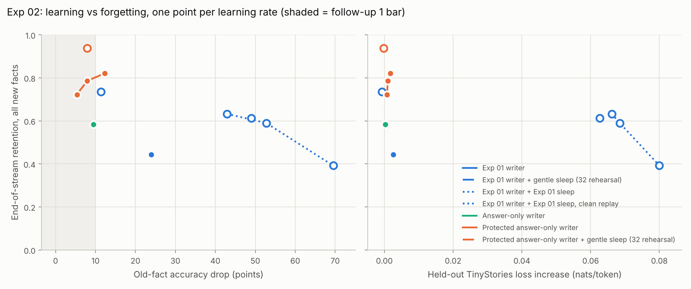

# Exp 02 results: Fixing the two bottlenecks of two-speed weights

**Bottom line.** Both fixes pass on the test streams, and so does their
combination, so the decision rule says scale up (Exp 03).

- **Wake fix (FU1).** The protected answer-only writer cuts old-fact loss from 24 points to 8
  and lifts retention from 0.44 to 0.79, at no cost to general text.
- **Sleep fix (FU2).** Gentle sleep turns sleep from a net harm (Exp 01: +19 points of old
  facts lost, +0.064 nats) into a net gain.
- **Combined.** Writer plus sleep keeps 94% of 500 new facts (90% on the held-out template)
  while losing 8 points of old facts and nothing on general text.

One caveat holds the "gentle" label back. The dense update in sleep still costs about 1.5
points of old facts per sleep. It passes only because resetting the written slots gives
more back. Over the 4 sleeps here that nets to zero; over the 19 sleeps of a 2,000-fact
stream it may not.

Test streams: seeds 1-3, 500 new facts each. That is 12 core runs, 12 extras, and the
Exp 01 runs reused as controls. The pretrained model, data and metrics are Exp 01's. L* = 4
and R = `gentle32` were frozen on dev before any test run (DESIGN.md, commits 7dd1be7 and
59b81ad).

## Verdict against the pre-registered rules

| Rule | Bar (means over seeds 1-3) | Result | Verdict |
|---|---|---|---|
| FU1: `p06ans` at L* = 4 | old-fact drop <= 10, retention >= 0.45; guards: held-out drop <= 10, held-out retention >= 0.40 | drop 7.9 ± 1.4, retention 0.79; held-out drop 6.6, held-out retention 0.67 | **Pass** (not marginal) |
| FU2: `C+gentle32` minus `C` (lr 16, paired) | dNLL <= +0.02, drop change <= +3, retention >= +0.10, same guards, consolidation loss <= 0.01 | dNLL -0.003, drop -12.6, retention +0.29; held-out drop -12.9, held-out retention +0.32; consolidation loss 0.000 | **Pass**, labelled "passes through slot-reset repair: the dense update still costs 6.1 points" (gentle needs <= 3.0) |
| Combined: `p06ans+gentle32` at L* | every FU1 criterion absolute, every FU2 criterion against `p06ans` | absolute: drop 7.9, retention 0.94, held-out 7.2 / 0.90; paired: retention +0.15, drop -0.1, dNLL -0.001, consolidation loss 0.000 | **Pass** |
| Scale up | FU1 and Combined pass | both pass | **Go** (Exp 03) |

The `C` reruns on test seeds are bit-identical to Exp 01's runs: every recorded metric,
checkpoint and log-prob matches on all three seeds. This covers the dense-weight path and
confirms that the new flags change nothing at their defaults.

## Results

Full table: [`results/table_seeds1-2-3.md`](results/table_seeds1-2-3.md). Decision rules
applied mechanically, with per-seed values: [`results/decision_seeds1-2-3.json`](results/decision_seeds1-2-3.json).

| Arm | LR | Retention | Held-out template | First 100 facts | Old-fact drop (pts) | Held-out drop | Delta NLL | Steps/fact |
|---|---|---|---|---|---|---|---|---|
| Exp 01 writer `C` | 16 | 0.44 | 0.38 | 0.30 | 23.9 ± 1.1 | 22.9 | +0.003 | 4.4 |
| `C` + Exp 01 sleep (raw replay) | 16 | 0.63 | 0.59 | 0.54 | 42.9 ± 5.0 | 42.4 | +0.066 | 3.9 |
| `C` + Exp 01 sleep, clean replay (E3) | 16 | 0.61 | 0.59 | 0.54 | 49.0 ± 6.2 | 48.4 | +0.063 | 4.0 |
| `C` + gentle sleep | 16 | 0.74 | 0.71 | 0.70 | 11.3 ± 3.0 | 10.0 | -0.001 | 3.7 |
| Answer-only writer `ans` (E2) | 0.5 | 0.58 | 0.48 | 0.47 | 9.5 ± 1.3 | 8.6 | +0.000 | 5.6 |
| Protected answer-only `p06ans` (E1) | 2 | 0.72 | 0.58 | 0.59 | 5.3 ± 1.5 | 4.8 | +0.001 | 5.0 |
| **Protected answer-only `p06ans`** | **4** | **0.79** | **0.67** | **0.66** | **7.9 ± 1.4** | **6.6** | **+0.001** | **3.0** |
| Protected answer-only `p06ans` (E1) | 8 | 0.82 | 0.72 | 0.73 | 12.3 ± 1.0 | 11.6 | +0.002 | 2.0 |
| **`p06ans` + gentle sleep** | **4** | **0.94** | **0.90** | **0.92** | **7.9 ± 0.4** | **7.2** | **-0.000** | **3.2** |

### 1. Wake: most of the damage came from training the name

The answer-only loss alone (`ans`) cuts the old-fact drop from 23.9 to 9.5 points. That
supports H1: the gradient that memorises a new name's spelling lands on the syllable-piece
slots that old names share.

Slot protection then buys retention at a similar or lower drop: 0.72 at 5.3 points (lr 2)
and 0.79 at 7.9 (lr 4), against `ans`'s 0.58 at 9.5. The two writers sit at different LRs,
so this is a frontier comparison, not an LR-matched ablation.

The LR sweep traces the trade-off cleanly:

| `p06ans` LR | 2 | 4 | 8 |
|---|---|---|---|
| Retention | 0.72 | 0.79 | 0.82 |
| Old-fact drop (pts) | 5.3 | 7.9 | 12.3 |

At lr 8 the writer fails the FU1 bar (12.3 > 10), as it did on dev.

Fewer write steps are needed, too: 3.0 per fact against the Exp 01 writer's 4.4.

### 2. Sleep: the reset repairs, the dense update still costs

Each sleep logs old-fact accuracy at three points:

- before sleep;
- after the written slots are reset to their pretrained values;
- after the dense update.

The sums over the 4 sleeps:

| Sleep | Writer | Reset gives back | Dense update takes | Net |
|---|---|---|---|---|
| Exp 01 sleep, clean replay | `C` | +22.4 | -41.0 | -18.6 |
| gentle32 | `C` | +17.9 | -6.1 | +11.8 |
| gentle32 | `p06ans` | +5.5 | -6.7 | -1.2 |

Gentle sleep cuts the dense update's damage about 7-fold compared with Exp 01's sleep
under the same clean replay. Exp 01's sleep did most of its damage in the first sleep
(23-26 points per seed), while gentle sleep's damage is flat at about 1.5 points per sleep.

With the protected writer there is less wake damage for the reset to repair (5.5 points).
The dense update's roughly 1.5 points per sleep then roughly cancels it.

Sleep also does what it is for:

- Self-labelled consolidation loses nothing: pre_all - post_all is 0.000.
- Retention rises by 0.15 to 0.29.
- The held-out-template gap closes. `p06ans` goes from 0.67 to 0.90 on template 7 after
  sleep, so the dense copy of a fact generalises across phrasings better than the
  slot copy does.

### 3. Correction to Exp 01: replay leak

Exp 01's sleep replayed raw pretraining text. About 9% of its windows touch a document that
names an eval entity, which rehearsed the very facts being probed. With the token-level
clean replay (E3), the same sleep loses 49.0 points of old facts, not 42.9, so Exp 01
understated sleep's damage by about 6 points.

Exp 01's verdict (sleep fails Q2) is unchanged. Every Exp 02 sleep arm uses clean replay.

## What this predicts for Exp 03 (2,000 facts, 19 sleeps)

These are written before Exp 03 runs, so they can be checked.

- **FU1 at scale.** The writer's old-fact drop grew roughly linearly over the 500-fact
  stream. If that holds, `p06ans` alone will exceed the 10-point bar at 2,000 facts unless
  the larger memory (4x the slots) dilutes collisions. That makes this the most likely
  failure at scale.
- **Combined at scale.** At about -0.3 points net per sleep (dense damage minus reset
  gain), 19 sleeps add about 6 points of old-fact loss. The combined arm's margin to the
  10-point bar (2.1 points here) would not survive that unless scale lowers the per-sleep
  damage.
- **What would change the picture.** If either fails, the next lever is the dense update,
  not the writer: rehearsal sized to the stream, or sleep that trains only the blocks above
  the memory layer.

## Compute

Everything ran on a 4-core CPU:

- dev: 3.7 CPU-hours;
- test: 4.6 CPU-hours (24 runs);
- a 500-fact run with sleep takes 16 minutes;
- a run without sleep takes 4 minutes.

## Deviations and caveats

- **When the selection rules were written.** The dev rules in DESIGN.md were written during
  the dev phase, after some dev screens had run. They were frozen before any test run, and
  the test seeds were never looked at before freezing. DESIGN.md's heading says so.
- **Dev stream.** The dev stream (seed 0) was used by the design panel's screens and by the
  freeze rules. No dev number enters the verdict.
- **Untested factors.** One pretrained model, one data distribution, one memory size: the
  same limits as Exp 01. Exp 03 lifts the first and the size.
- **"Marginal" flags.** None of the deciding means sits within one across-seed SD of its
  threshold.
