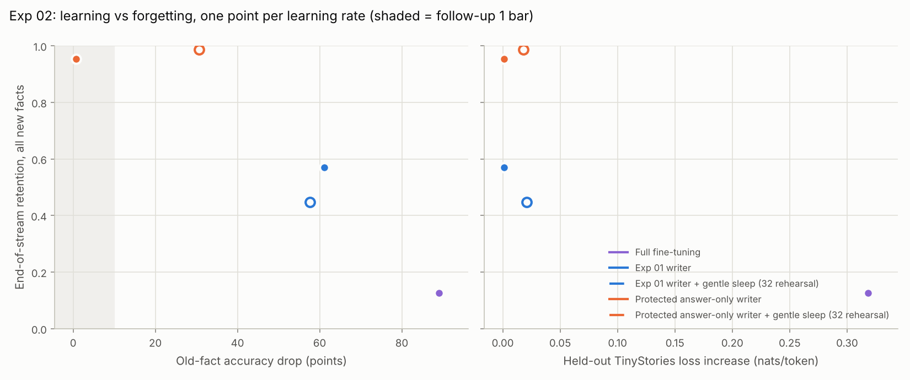

# Exp 03 results: the Exp 02 recipe at 8x scale and 4x longer streams

> **Status: 14 of 15 test runs done.** The last one, `C+gentle32` seed 1, is saved at 500
> of 2,000 facts and resumes on the next free Colab runtime. It cannot change any verdict
> below (bounds given), but DESIGN.md asks for all runs before the formal verdict. This page
> is updated when it lands.

**Bottom line.**

- **The wake fix scales.** On three test streams of 2,000 new facts, the protected
  answer-only writer keeps **0.95** of them and loses **0.7 points** of old facts, with
  general text untouched (+0.001 nats).
  - Without protection, the Exp 01 writer loses 61 points.
  - Full fine-tuning loses 89 points and keeps 0.13 of the facts.
- **The sleep fix does not scale.** Gentle sleep lifts retention to 0.99 but costs **31
  points** of old facts, and the recipe fails its bar.
  - The cost is all dense update: about 1.6 points per sleep, accumulating over 19 sleeps.
  - Paired with the unprotected writer, the same sleep *lowers* retention (0.57 → 0.45),
    because it consolidates the writer's own mistakes.
- **What this means for two-speed weights at this scale:** the fast weights carry the
  learning and the slow weights get in the way. The next experiment should change or drop
  the dense consolidation, not the writer.

Full table: [`results/table_seeds1-2-3.md`](results/table_seeds1-2-3.md). The decision
rules, applied mechanically with per-seed values, are in
[`results/decision_seeds1-2-3.json`](results/decision_seeds1-2-3.json). The run files are
in `results_attempt2/`.

## Verdict against the pre-registered rules

| Rule (means over seeds 1-3) | Result | Verdict |
|---|---|---|
| **FU1:** `p06ans` at L* = 4 (bar: drop <= 10, retention >= 0.45; guards: held-out drop <= 10, held-out retention >= 0.40) | drop 0.7 ± 0.5, retention 0.953; held-out 0.8 / 0.850 | **Pass** (not marginal) |
| **FU2:** `C+gentle32` minus `C` at lr 16 (bar: dNLL <= +0.02, drop change <= +3, retention change >= +0.10, same guards, consolidation intact) | 2 of 3 pairs: retention -0.125, held-out -0.094, drop -3.2, dNLL +0.020, consolidation intact | **Fail** on retention. Not formally final: one pair is missing, but the third pair would need +0.55, above any possible value. |
| **Combined:** `p06ans+gentle32` at L* = 4 (FU1 bar absolute, FU2 bar against `p06ans`) | drop 30.7 ± 2.3, retention 0.987; paired retention +0.034, drop +30.0 | **Fail** |
| **The recipe scales** (FU1 and Combined) | | **No** |

## Results (test, seeds 1-3, 2,000 facts each)

Old-fact drop and held-out drop are in points.

| Arm | LR | Seeds | Retention | Held-out | First 100 | Old-fact drop | Held-out drop | Delta NLL |
|---|---|---|---|---|---|---|---|---|
| Full fine-tuning `A` | 3e-5 | 3 | 0.13 | 0.12 | 0.06 | 89.0 ± 0.5 | 87.9 | +0.319 |
| Exp 01 writer `C` | 16 | 3 | 0.57 | 0.54 | 0.43 | 61.1 ± 1.3 | 62.3 | +0.001 |
| `C` + gentle sleep | 16 | 2 | 0.45 | 0.45 | 0.24 | 57.6 ± 2.6 | 57.0 | +0.021 |
| **Protected answer-only `p06ans`** | **4** | **3** | **0.95** | **0.85** | **0.93** | **0.7 ± 0.5** | **0.8** | **+0.001** |
| `p06ans` + gentle sleep | 4 | 3 | 0.99 | 0.98 | 0.99 | 30.7 ± 2.3 | 30.3 | +0.018 |

### 1. Writing: protection becomes more important, and works better, at scale

| Writer | 3.8M model, 500 facts (Exp 02) | This model, 2,000 facts |
|---|---|---|
| Exp 01 writer | 23.9 points lost | 61.1 points lost, 37 of them within the first 250 facts (dev) |
| Protected answer-only | 7.9 points lost | 0.7 points lost; on dev the drop stays under 0.5 for the whole stream |

- Before the run, Exp 02 predicted that the protected writer would cross 10 points at 2,000
  facts. It did not. In the larger memory, protection removes nearly all overlap with what
  old entities read.
- Several things changed at once between the two columns: model, memory size, top-k,
  context, stream length and LR. So this compares two configurations and isolates no single
  factor (see Limits).

### 2. Sleep: the dense update is the bottleneck, and it does not shrink with scale

Each sleep logs old-fact accuracy before the sleep, after the written slots are reset, and
after the dense update. All figures are in points.

| Arm | Reset gives back (sum over 19 sleeps) | Dense update takes (sum) | Dense update per sleep |
|---|---|---|---|
| `p06ans` + gentle sleep (3 seeds) | -1.2 | 30.8 | 1.6 |
| `C` + gentle sleep (2 seeds) | 462 (about 24 per sleep) | 37.8 | 2.0 |
| *Exp 02, 3.8M model, `p06ans` + gentle sleep (4 sleeps)* | *5.5* | *6.7* | *1.7* |

With the protected writer there is nothing for the reset to repair, so each sleep is a pure
cost.

- **The cost is steady.** The old-fact loss grows from about 3-5 points after 250 facts to
  about 31 by the end.
- **It matches the 3.8M model.** The per-sleep rate (1.6) is the same as Exp 02 measured
  on the smaller model.
- **The damage lands on knowledge the sleep never sees.** The probed old entities are
  excluded from rehearsal by design, so this is interference on facts outside the training
  data. Rehearsing other old entities (32 sentences per step) does not protect them.

**Sleep does its own job almost perfectly.**

- Self-labelling accuracy is 0.99.
- Consolidation loses 0.0002 on average.
- Retention rises to 0.99, and the held-out template rises from 0.85 to 0.98. So
  consolidation generalises a fact across phrasings.

The cost is entirely collateral.

### 3. Why sleep hurts the unprotected writer

- **The writer wipes old facts, and the reset undoes it.** The Exp 01 writer wipes about 25
  points of old facts in every 100-fact block. Resetting its slots restores them (old-fact
  accuracy is back to 0.93-1.00 after each reset).
- **But the sleep consolidates whatever the model answers.** By sleep time, the writer
  answers only about 63% of the stream correctly (self-labelling accuracy 0.62-0.64). Sleep
  writes those answers, wrong ones included, into the dense weights.
- **So retention falls** from 0.57 to 0.45.

Self-labelled consolidation is only as good as the fast weights it reads from.

## Exp 02's predictions, checked

| Prediction (written before Exp 03 ran) | Outcome |
|---|---|
| The protected writer alone exceeds 10 points at 2,000 facts | **Wrong:** 0.7 points |
| At about 0.3 points net per sleep, the combined arm's 2.1-point margin will not survive 19 sleeps | **Right, and worse:** the reset gave back nothing at scale, so the net cost was the full 1.6 per sleep, for 30.7 points |
| If either fails, the next lever is the dense update, not the writer | Holds |

## Limits

- **Scale is confounded.** The "scale" comparison changes model size, memory size, top-k,
  context, stream length and the selected LRs together. Separating them needs single-factor
  ablations on one model: stream length alone, memory size alone.
- **Toy setting.** The data is TinyStories and synthetic entities with 6 relations. Answers
  are single tokens, and probes are cloze prompts scored among each relation's candidate
  values (chance is about 7%). Nothing here tests real facts or a real pretrained LLM.
- **One pretrained model** for all test runs, plus attempt 1's lost model. Attempt 1 agrees
  within a few points on dev and on its 2 test runs.
- **Few seeds and noisy sleeps.** The per-sleep damage varies from -3.5 to +6.5 points
  between sleeps. The 1.6-point mean rests on 57 sleeps over 3 seeds.
- **Missing baselines.** There are no replay-based continual learning, LoRA, model-editing
  (ROME/MEMIT) or EWC baselines at this scale. Exp 01 covered LoRA and EWC at the smaller
  scale only.

## Next (Exp 04 candidates; not yet pre-registered)

1. **Writer only, no sleep:** test whether its 0.95 retention holds over longer streams
   (10K facts) and more seeds.
2. **Sleep without collateral damage:**
   - train only the blocks above the memory layer;
   - consolidate into a fresh memory region;
   - or sleep less often (the damage is per sleep).
3. **Sleep that cannot learn the writer's mistakes:** consolidate only facts the model
   answers with high confidence. A model-free alternative is to keep the stream text and
   label from it rather than from self-quizzing.
4. **Single-factor ablations** to turn "at scale" into specific claims: stream length,
   memory size and top-k, each varied alone on one model.

## Setup and logistics

| | |
|---|---|
| Model | 8 layers, d 512, ctx 256; 26M dense + 134M memory parameters (512² slots, 4 heads x top-32) |
| Pretraining | 299M tokens, fp16 on a free T4, resumed once across runtimes |
| Pretrained model | held-out loss 1.268; old-fact accuracy 1.00 on template 0 and 1.00 on the held-out template (validity bar: 0.80) |
| Dev, seed 0 (`results_attempt2/dev/`) | L* = 4 for `p06ans` (eligible, no flag); C LR = 16; A LR = 3e-5; R = gentle32, fixed by Exp 02 |
| Attempt 1 (`results_attempt1/`) | Same data, a different pretrained model, lost before its test finished. Reported, not counted. |

**Hardware.** The Colab account had no compute units and no A100 access, so everything ran
on free T4 runtimes. `colab_cli_runner.py` drove them through the Colab CLI. Runtimes lasted
2-5 hours, and a new one was granted about once a day.

**Problems, and the checked fixes they forced:**

- **T4 has no bf16.** Pretraining switched to fp16: same loss, 2.9x faster.
- **The 12 GB VM ran out of memory** reading the corpus. `data.py` now streams it.
- **The runtime's file API returned errors.** Copies now go over SSH at about 20 MB/s.
  Attempt 1's model was lost before this fix.
- **Runtimes were reclaimed mid-run.** Stream runs are now resumable. On CPU, a run
  interrupted and resumed is identical to an uninterrupted one.
- **A lost GPU runtime was silently replaced by a CPU one.** The runner now detects and
  replaces it.
